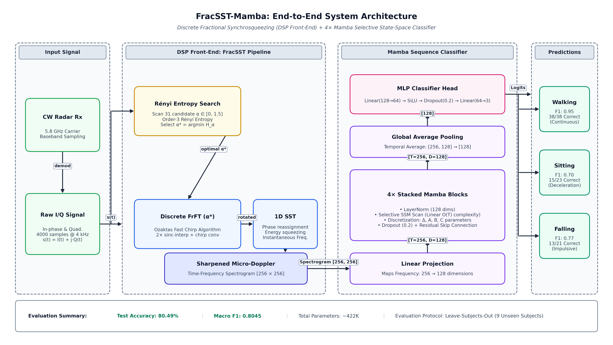

# FracSST-Mamba: Physics-Aware Radar Human Activity Recognition

[](https://opensource.org/licenses/MIT)
[](https://www.python.org/)
[](https://pytorch.org/)
[](https://streamlit.io/)

---

## Overview

**FracSST-Mamba** is a physics-aware deep learning framework designed for **Radar Human Activity Recognition (HAR)** and temporal micro-Doppler activity segmentation. It addresses the fundamental challenge in continuous-wave (CW) radar signal processing: **micro-Doppler spectral smearing** caused by accelerating human body parts (e.g., swinging limbs during walking or falling).

The pipeline fuses:
- **Stage 1 — Deterministic DSP Front-End**: Fractional Fourier Transform + Synchrosqueezing (FracSST) to eliminate spectral smearing and sharpen time-frequency representations.
- **Stage 2 — Deep Learning Backbone**: A Mamba Selective State-Space Model (SSM) with Dual Attention for efficient long-context temporal activity recognition and frame-level segmentation.

### Key Contributions
- **Physics-informed preprocessing**: Uses Fractional Fourier Transform (FrFT) to rotate radar signals into the optimal fractional domain — automatically selected by minimizing Rényi Entropy ($\alpha_R=3$) — before applying Synchrosqueezing to reassign spectral energy to instantaneous frequency ridges.
- **Efficient sequence modeling**: Replaces transformer attention ($O(N^2)$ complexity) with Mamba's selective SSM ($O(N)$), enabling real-time inference on radar frame sequences.
- **Multi-task learning**: Simultaneously predicts a global sequence-level activity class (Walk, Sit, Fall) and a frame-level temporal segmentation mask.
- **Live demonstration dashboard**: Interactive Streamlit app simulating a real-time radar processing feed for evaluators.

---

## Architecture



### Stage 1: FracSST Digital Signal Processing (DSP)

The DSP front-end is a **deterministic, trainable-free** preprocessing stage:

1. **Optimal α Selection via Rényi Entropy Minimization** (`dsp/frft.py` → `find_optimal_alpha`):
   - Scans candidate fractional rotation orders $\alpha \in [0, 1.5]$.
   - Computes the Rényi Entropy of order 3 for each rotated signal's time-frequency representation:
     $$R_3(\alpha) = -\frac{1}{2} \ln \left( \sum_{i,j} P_\alpha(i, j)^3 \right)$$
   - Returns the $\alpha^*$ minimizing $R_3$ — the order where chirp-like Doppler components concentrate into the sharpest energy ridges.

2. **Fractional Domain Rotation** (`dsp/frft.py` → `frft`):
   - Implements the **Ozaktas fast chirp-multiplication algorithm** to compute the 1D Fractional Fourier Transform.
   - Handles boundary conditions ($a \in \{0, 1, 2, 3\}$) using standard FFT/iFFT.
   - Preserves Parseval energy ($L_2$ norm invariance) across all fractional orders.

3. **Synchrosqueezing Energy Reassignment** (`dsp/synchrosqueezing.py` → `fracsst_1d`):
   - Computes the STFT using a Hamming window $w(t)$ and its time derivative $w'(t)$.
   - Estimates instantaneous frequencies via the phase derivative:
     $$\omega_{\text{inst}} = f_{\text{bin}} - \frac{1}{2\pi} \text{Im}\left( \frac{\text{STFT}_{w'}(t, f)}{\text{STFT}_w(t, f)} \right)$$
   - Reassigns STFT spectral energy from blurry bins to $\omega_{\text{inst}}$ frequency ridges, producing a sharpened `(256 × 16)` spectrogram matrix.

### Stage 2: DASegModel — Dual-Attention Mamba Segmentation Network

The neural network backbone processes the FracSST-sharpened spectrogram:

1. **2D Convolutional Spectral Stem**: Two Conv2D layers with BatchNorm and SiLU activations extract spatial spectral features from the `(1, 256, 16)` spectrogram tensor.
2. **Adaptive Frequency Pooling**: Collapses the frequency axis to produce a temporal sequence `(B, T=16, d_model=128)`.
3. **Channel Attention**: Learns which frequency-mapped features to emphasize across the time sequence.
4. **Temporal Self-Attention**: Multi-head attention over the temporal frame axis for global context.
5. **Stacked Mamba SSM Blocks (×4)**: Selective State-Space Model blocks process the attended sequence. Supports native CUDA `mamba_ssm` kernels with automatic CPU fallback.
6. **Multi-Task Output Heads**:
   - **Classification Head** → Global activity class logits `(B, 3)`
   - **Segmentation Head** → Frame-level activity mask logits `(B, T, 3)`

---

## Project Structure

```
FracSST-Mamba/
├── assets/
│   └── architecture.png       # Architecture diagram
├── config/
│   └── params.yaml            # Global hyperparameter configuration
├── data/
│   ├── raw/                   # Raw radar signals (.npy, .mat, etc.)
│   ├── interim/               # Intermediate converted/filtered signals
│   ├── processed/             # FracSST preprocessed tensors (.pt)
│   ├── metadata/              # Dataset annotations, subject splits, manifests
│   ├── __init__.py
│   ├── schema.py              # Standard RadarSample dataclass & BaseRadarDatasetAdapter
│   ├── synthetic_fixtures.py  # Isolated synthetic signals for testing & verification
│   └── dataset.py             # PyTorch Dataset & DataLoader factory
├── dsp/
│   ├── __init__.py
│   ├── frft.py                # 1D Fractional Fourier Transform & Rényi Entropy search
│   └── synchrosqueezing.py    # sst_1d, fracsst_1d, and high-level frsst(signal, ...) API
├── models/
│   ├── __init__.py
│   ├── mamba_block.py         # Mamba SSM block (Native CUDA + PyTorch CPU fallback)
│   └── da_seg.py              # Dual-Attention Activity Segmentation Model
├── scripts/
│   └── run_dsp_demo.py        # Standalone DSP verification & visualization (Zero PyTorch/Mamba dependency)
├── utils/
│   ├── __init__.py
│   ├── metrics.py             # Accuracy, Precision, Recall, F1, mIoU calculators
│   └── visualization.py       # Spectrogram & segmentation plotters
├── weights/
│   └── best_model.pth         # Best checkpoint (saved on validation accuracy improvement)
├── app.py                     # Streamlit live demo dashboard
├── preprocess.py              # Offline DSP preprocessing script
├── train.py                   # Main training & validation loop
├── test_dsp.py                # Stage 1 DSP unit test suite (unittests, zero ML dependency)
├── test_models.py             # Stage 2 neural network verification tests
└── requirements.txt
```

---

## Architecture Layers

The repository is organized into cleanly separated layers:

1. **DATA LAYER** (`data/`):
   - `data/schema.py`: Defines the uniform internal `RadarSample` representation (complex I/Q signal, sampling rate, activity label, subject ID, recording ID, metadata) and `BaseRadarDatasetAdapter`.
   - Dataset adapters convert raw benchmark data (DIAT, CI4R, UoG) into `RadarSample` objects without altering DSP code.
   - `data/synthetic_fixtures.py`: Synthetic chirps isolated exclusively for unit tests and smoke tests.
2. **SIGNAL PROCESSING / DSP LAYER** (`dsp/`):
   - Standalone DSP pipeline with zero PyTorch/Mamba dependencies.
   - Functions: `frft()`, `find_optimal_alpha()`, `sst_1d()`, `fracsst_1d()`, and the high-level `frsst(signal, sampling_rate=...) -> FrSSTResult`.
3. **FEATURE REPRESENTATION LAYER**:
   - `FrSSTResult`: Encapsulates the sharpened time-frequency matrix `(n_freq_bins, n_frames)` alongside coordinate frequency and time axes.
4. **MODEL LAYER** (`models/`):
   - `DASegModel` and `MambaBlock`: Decoupled sequence models expecting generic tensor representations.
5. **TRAINING & EVALUATION LAYER** (`train.py`, `utils/`):
   - Multi-task optimization, validation, and metrics.
6. **STANDALONE SCRIPTS & DEMO** (`scripts/run_dsp_demo.py`, `app.py`):
   - `run_dsp_demo.py`: Pure DSP demonstration runnable on CPU without ML packages.

---

## Installation

```bash
git clone https://github.com/AdityaTummuri/FracSST-Mamba.git
cd FracSST-Mamba

# Create and activate virtual environment
python3 -m venv .venv
source .venv/bin/activate    # Linux / macOS
# .venv\Scripts\activate     # Windows

# Install dependencies (DSP core + optional deep learning)
pip install -r requirements.txt
```

> **Note**: `mamba-ssm` and `causal-conv1d` require CUDA and a C++ build toolchain. On CPU-only machines, the code automatically falls back to the pure-PyTorch `PyTorchSelectiveSSM` implementation — no manual changes needed.

---

## Usage

### 1. Run Standalone DSP Demo (Zero PyTorch/Mamba dependency)
```bash
python scripts/run_dsp_demo.py
```
Processes a radar chirp signal, executes FrFT, SST, and FrSST, prints mathematical metadata, and renders a side-by-side time-frequency comparison figure.

### 2. Run DSP Unit Tests
```bash
python -m unittest test_dsp.py
```
Tests FrFT boundary conditions, Parseval energy norm preservation, SST energy reassignment, and FrSST API contracts.

### 3. Preprocess Radar Data
```bash
python preprocess.py
```
Scans `data/raw/` for radar files, applies the FrSST DSP pipeline, and writes `.pt` feature tensors into `data/processed/`.

### 4. Train the Model
```bash
# Full training run (reads config/params.yaml)
python train.py

# Override epochs or batch size inline
python train.py --epochs 100 --batch-size 16

# Quick 1-epoch dry run to verify pipeline
python train.py --dry-run
```

### 5. Launch Live Demo Dashboard
```bash
streamlit run app.py
```
Open [http://localhost:8501](http://localhost:8501) → Click **"🛰️ Simulate Live Radar Feed"** to watch the pipeline process samples in real-time.

### 6. Verify Neural Network Architecture
```bash
python test_models.py
```

---

## Configuration

Edit `config/params.yaml` to control all pipeline parameters:

```yaml
dsp:
  sampling_rate: 1000       # Hz
  n_fft: 256                # FFT window length
  hop_length: 64            # STFT hop size
  fractional_order_alpha: 0.5   # Fixed α (used if not auto-searching)

model:
  d_model: 128              # Mamba feature dimension
  n_layers: 4               # Number of stacked Mamba SSM blocks
  dropout: 0.1              # Dropout rate
  num_classes: 3            # Walk (0), Sit (1), Fall (2)

training:
  batch_size: 32
  lr: 0.001
  epochs: 50
```

---

## Activity Classes

| Class ID | Activity | Description |
|:---:|:---|:---|
| 0 | **Walk** | Periodic sinusoidal chirp with limb-swing micro-Doppler modulation |
| 1 | **Sit** | Low-frequency baseline micro-Doppler signature |
| 2 | **Fall** | Sudden high-acceleration quadratic frequency burst |

---

## Loss Function

The model is trained with a combined multi-task loss:

$$\mathcal{L}_{\text{total}} = \mathcal{L}_{\text{cls}} + \mathcal{L}_{\text{seg}}$$

- $\mathcal{L}_{\text{cls}}$: `CrossEntropyLoss` over global sequence class predictions.
- $\mathcal{L}_{\text{seg}}$: `CrossEntropyLoss` over frame-level temporal segmentation predictions.

Optimizer: `AdamW` with weight decay $10^{-4}$.

---

## Citation

If you use this repository in your research, please cite:

```bibtex
@software{Aditya_FracSST-Mamba_2026,
  author = {Aditya, T. and Krishna, Y. and Varshitha, G.},
  title  = {FracSST-Mamba: Physics-Aware Radar Human Activity Recognition},
  version = {1.0.0},
  date   = {2026-07-24}
}
```

---

## License

This project is licensed under the [MIT License](LICENSE).
